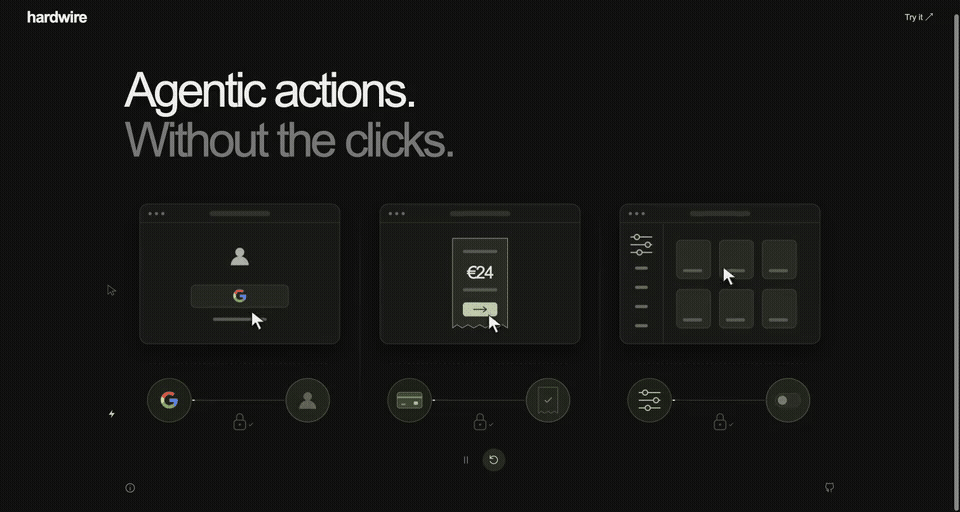

# Hardwire

**Agentic actions. Without the clicks.**

Turn a saved HTML form into an action contract. Check its inputs and approval
rules, then generate an MCP tool description for your agent integration.

The goal is simple: applications should tell agents what they can do, what each
action changes and which approval it needs. Hardwire provides the format and
checks. Your application supplies the authorized handler.

[Try the three actions](https://automatron-workflows.github.io/hardwire/experiment.html)
· [Watch the demo](https://automatron-workflows.github.io/hardwire/)
· [Download](https://github.com/Automatron-workflows/hardwire/releases/tag/v0.9.0)
· [MCP Registry](https://registry.modelcontextprotocol.io/v0.1/servers?search=io.github.Automatron-workflows/hardwire)
· [Ask a question](https://github.com/Automatron-workflows/hardwire/discussions/categories/q-a)

[](https://github.com/Automatron-workflows/hardwire/actions/workflows/test.yml)
[](https://github.com/Automatron-workflows/hardwire/actions/workflows/browser.yml)

[](https://automatron-workflows.github.io/hardwire/)

## One form. One command.

With Node 22 or newer, run the bundled email preference from the demo:

```sh
npx --yes --ignore-scripts --package=https://github.com/Automatron-workflows/hardwire/releases/download/v0.9.0/hardwire-0.9.0.tgz hardwire-form
```

```text
Candidate action: preferences
Accepted: {"marketingEmails":false}
Rejected: {"marketingEmails":"false"}
MCP tool: preferences
```

Add `--json` to inspect the contract and generated tool. No app, account or API key
is required. The command parses HTML locally and never calls its endpoint.
[Bring your own saved form](docs/FORM-EXPERIMENT.md).

## See the same idea in three familiar actions

[Open the visual experiment](https://automatron-workflows.github.io/hardwire/experiment.html).
Run an action, try invalid input and inspect the result if you want the details.

| Scene | What you test |
| --- | --- |
| Sign in | A local session requires valid input and explicit consent. |
| Invoice | The exact €24 invoice requires owner approval; altered input is rejected. |
| Settings | A boolean changes a reversible preference; a string is rejected. |

These use the real validator and fixed local JavaScript handlers. Google sign in
is simulated and no money moves. The film illustrates the idea; it is not a speed
benchmark. [Run all three in your terminal](docs/EXPERIMENT.md).

## Put it in an MCP client

[Download the desktop bundle](https://github.com/Automatron-workflows/hardwire/releases/download/v0.9.0/hardwire-0.9.0.mcpb)
for a host that supports MCPB and Node 22 or newer. It includes the server and its
runtime dependencies. No npm installation is needed to run the extracted bundle.

The server exposes five tools for inference, contract inspection, input checking,
MCP description generation and trace verification. It operates on supplied data.
It cannot browse files, connect accounts or execute the described application actions.

[Desktop installation and verification](docs/DESKTOP-BUNDLE.md)
· [Other MCP clients and a first prompt](docs/MCP.md)

The bundle is tested through real MCP calls after extraction. Native host setup
remains a separate verification task. GitHub packages and bundles are available;
the npm name is not reserved. Do not install the unrelated unscoped npm package.

## Add it to your project

Install the pinned release from GitHub:

```sh
npm install --ignore-scripts github:Automatron-workflows/hardwire#v0.9.0
```

[Use the library on one known action](docs/ADOPT.md), or use the guide’s MCP
configuration to connect without cloning the repository.

## Where it fits

| You already have | Hardwire adds |
| --- | --- |
| An API or OpenAPI description | Explicit declared effects and approval floors to review alongside input types. |
| An MCP server | Contract checks before trusted handlers run. Generated descriptions remain data until you wire them in. |
| A saved HTML form | A candidate contract and testable input schema, ready for review. |
| Browser automation | A way to describe known operations when the application can expose them. No browser driver is included. |

A **panel** describes an application's actions. A **port** is one action with an
input schema, declared effect and confirmation requirement. A **trace** binds a
caller's record to a panel revision. Digests check consistency; they do not prove
identity, execution or approval. [Read the format](docs/SPEC.md).

## Experimental, with explicit limits

Inference cannot establish actual endpoint behavior, reversibility or permission.
The benchmark has six synthetic fixtures, with scores of 100, 80, 60, 45, 40
and 40; two pass at 80. The settings case shows why a checkbox alone cannot
establish a required boolean, the absence of confirmation, or reversibility. The
sign-in case leaves session reversibility to a reviewer. The invoice case
records why static inference cannot establish a payment effect or owner
approval. None establishes accuracy on real websites. No general executor or
WebMCP adapter is included. [Evidence and next gates](docs/ROADMAP.md).

## Bring one form

Run the experiment and [share the first confusing step](https://github.com/Automatron-workflows/hardwire/issues/new?template=experiment.yml).
The [saved-form invitation](https://github.com/Automatron-workflows/hardwire/discussions/28)
has the public v0.9.0 command and the questions to answer. Synthetic forms,
reproducible bugs and verified client setups are useful
[small contributions](https://github.com/Automatron-workflows/hardwire/issues?q=is%3Aissue%20is%3Aopen%20label%3A%22good%20first%20issue%22).

[Community welcome](https://github.com/Automatron-workflows/hardwire/discussions/18)
· [Contributing](CONTRIBUTING.md) · [Support](SUPPORT.md)

If Hardwire is useful to you, star the repository to find it again.

## Build and explore

```sh
git clone https://github.com/Automatron-workflows/hardwire.git
cd hardwire
npm ci --ignore-scripts
npm run check:quick
npm run dev
```

[Daily development and maintainer handoff](MAINTAINING.md) includes the next task,
file map, release steps and launch routine. Run `npm run check` before merging.
No AI subscription or API key is needed to build on this repository.

[API](docs/API.md) · [Architecture](docs/ARCHITECTURE.md)
· [Integration](docs/INTEGRATION.md) · [Security](SECURITY.md)
· [Distribution](docs/DISTRIBUTION.md) · [Launch status](docs/LAUNCH-STATUS.md)

MIT licensed. An Automatron project.
