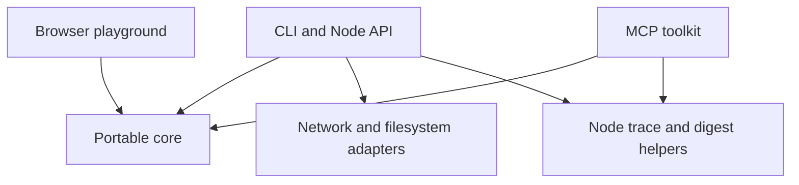

# Architecture

Hardwire turns application action descriptions into data that an integration can
review and validate. The same core serves the browser playground, Node library,
CLI and local MCP server. The panel and trace formats remain version 1.

## Boundaries

| Module | Responsibility | Allowed effects |
| --- | --- | --- |
| `panel-schema.mjs` | Normalize contracts, enforce confirmation floors, validate arguments, summarize declarations | None |
| `infer-html.mjs` | Extract candidate actions from static HTML and create reviewable drafts | None |
| `mcp.mjs`, `score.mjs`, `canonical.mjs` | Compile descriptions, compare contracts and encode bounded JSON | None |
| `browser.mjs` | Export portable functions and async panel hashing through Web Crypto | Platform hashing only |
| `panel.mjs`, `trace.mjs` | Preserve the synchronous Node API and build or check trace digests | Node cryptography |
| `probe.mjs`, `infer.mjs`, `corpus.mjs` | Explicit network and filesystem operations | Bounded reads through documented adapters |
| `toolkit.mjs`, `mcp-server.mjs` | Expose five fixed inspection tools through the official MCP SDK | Stdio transport; no supplied action execution |
| `playground/model.mjs`, `worker.mjs` | Keep the bounded inspection helpers available for experiments | Worker messaging only |
| `playground/calendar.mjs` | Validate and dispatch four fixed calendar handlers; bind approval to exact requests | In memory demo calendar and call log |
| `playground/app.mjs` | Coordinate the scripted task, show proposals and collect explicit approval | Local DOM only |

The Node entry points remain compatible. `hardwire/browser` has no Node imports,
polyfills, package dependencies, filesystem or network adapter. Its
`panelDigestAsync` produces the same SHA256 value as Node's synchronous
`panelDigest`. Both hash the same canonical normalized panel. Platform crypto
provides hashing in both environments.

## Playground data flow

A visitor asks to move Friday's meetings to Monday. The application publishes
a fixed panel with four typed actions: list events, plan a move, apply a move and
undo. The scripted agent normalizes that panel and compiles MCP tool descriptions.
It calls the first two actions to read meetings and compute available times.
This is local discovery of a supplied contract, not website crawling or an LLM.

Every call snapshots its inputs, compares the supplied panel digest to the
reviewed contract, validates the arguments with the shared core and dispatches
only a known application handler. Planning uses the actual fixture calendar to
avoid overlapping meetings. A proposal does not change any event.

The two writes declare user confirmation. The application issues a one use
approval object only from an explicit Approve or Undo control. It is bound to
the action, exact arguments, calendar version and application instance. The
handler also checks the proposal or change ID, recomputes conflicts before an
atomic replacement, and refuses stale or repeated requests. This is a local
example of approval enforcement, not a remote authorization protocol or defense
against arbitrary scripts already running in the same page.

The application reads both days back after a move and renders actual state.
Undo restores the original meetings. Cancelling discards the proposal and an
aborted call cannot dispatch after its asynchronous validation. The optional
action log contains actual successful calls and their panel digest. It is an
in memory debug record, not a signed receipt or a Hardwire trace.

The calendar uses bounded fixtures on the main thread with no artificial waits.
The existing inspection worker remains separate and is not loaded by this
journey. No account is connected. No calendar data is persisted or sent to a
server. Reloading starts a new example. Page delivery uses the hosting provider.
The Node consumer remains a separate fake catalogue example.

## Serving and distribution

`npm run demo` serves the playground at `/playground/` and keeps the original
fixture origin at `/` for probe and inference experiments. The server serves an
explicit asset allowlist. It does not expose repository files through arbitrary
paths. The packaged demo includes the same assets as the checkout.

`npm run build:playground` copies only portable source modules, static assets and
the license into `output/playground`. There is no bundler or third party script.
The public GitHub Pages workflow runs the full checks before deploying this
artifact from main. GitHub Pages must use GitHub Actions as its publishing source.
The workflow uses pinned actions and grants deployment permissions only to the
deploy job. It needs no persistent publishing token.

Rollback the demo by reverting a change on main and letting the workflow deploy
again. Package releases use immutable version tags and checksummed tarballs;
publish a new version to change a package. Do not replace existing assets.

## Verification and remaining scope

Tests cover cross runtime output and digest parity, schema enforcement, malformed
and oversized inputs, inference limits, static packaging, local HTTP serving and
installed package exports. Existing tests also cover the official MCP transport,
trace consistency and known corpus failures. Browser acceptance checks cover
planning, approval, calendar results, undo, cancellation, keyboard recovery and
responsive layout. Calendar tests reject changed contracts, malformed arguments,
forged or reused approvals, replaced proposals and stale versions. They verify
atomic results, cancellation before dispatch and isolation from caller mutations.

This is a complete foundation for describing and experimenting with actions. A
general execution system remains outside the implementation: it would need
application owned handlers, authentication, authorization, real approval checks,
result validation and retry policies. An inferred effect is a guess. A matching
digest establishes consistency, not authenticity or execution. See
[the roadmap](ROADMAP.md) for the evidence required before expanding that scope.
