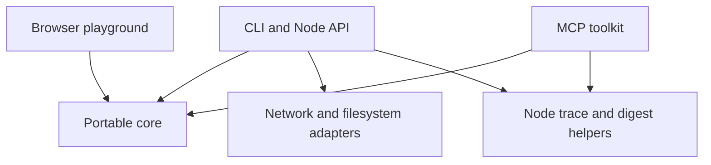

# Architecture

Hardwire turns application action descriptions into data that an integration can
review and validate. The same core serves the browser playground, Node library,
CLI and local MCP server. The panel and trace formats remain version 1.

## Boundaries

| Module | Responsibility | Allowed effects |
| --- | --- | --- |
| `panel-schema.mjs` | Normalize contracts, enforce confirmation floors, validate arguments, summarize declarations | None |
| `infer-html.mjs` | Extract candidate actions from static HTML and create reviewable drafts | None |
| `mcp.mjs`, `score.mjs`, `canonical.mjs` | Compile descriptions, compare contracts and encode bounded JSON | None |
| `browser.mjs` | Export portable functions and async panel hashing through Web Crypto | Platform hashing only |
| `panel.mjs`, `trace.mjs` | Preserve the synchronous Node API and build or check trace digests | Node cryptography |
| `probe.mjs`, `infer.mjs`, `corpus.mjs` | Explicit network and filesystem operations | Bounded reads through documented adapters |
| `toolkit.mjs`, `mcp-server.mjs` | Expose five fixed inspection tools through the official MCP SDK | Stdio transport; no supplied action execution |
| `playground/model.mjs`, `worker.mjs` | Keep the bounded inspection helpers available for experiments | Worker messaging only |
| `playground/comparison.mjs` | Validate and dispatch fixed session, invoice and preference handlers; bind approval to exact requests | Local fixtures and call records |
| `playground/experiment-model.mjs`, `experiment.mjs` | Review requests, collect explicit local approval and show fixture results | Browser memory and DOM |
| `examples/experiment.mjs` | Exercise all three handlers and assert rejection, result and duplicate behavior | Local fixtures and stdout |
| `examples/calendar.mjs` | Plan and apply an approved batch with conflict checks and undo | In memory calendar example |
| `playground/app.mjs` | Render a silent SVG film with pause, replay and visibility controls | Local DOM only |

The Node entry points remain compatible. `hardwire/browser` has no Node imports,
polyfills, package dependencies, filesystem or network adapter. Its
`panelDigestAsync` produces the same SHA256 value as Node's synchronous
`panelDigest`. Both hash the same canonical normalized panel. Platform crypto
provides hashing in both environments.

## Playground data flow

The public page is a silent SVG film. Three parallel scenes illustrate Google
sign in, an invoice payment and email settings. A cursor progresses through
interface states while a direct path reaches the same pictured outcome.
`app.mjs` contains only fixed artwork and a bounded animation clock. It does not
import the executor examples, issue approval objects, authenticate users, call
application handlers or send network requests. The scenes describe an integration
with authorized sessions and approved payments; they do not bypass those duties.

One animation clock coordinates the scenes. CSS transitions handle the small
camera movements, cursor travel, interface changes and direct paths. DOM state
changes occur only at scene boundaries. Pause freezes the clock and animations;
replay starts a fresh loop. Visibility and intersection observers stop work while
the page or film is hidden. Reduced motion starts with a still result and disables
transitions. All art has screen reader descriptions, and controls have accessible
names. The information note stays collapsed until requested. The timing is an
illustration, not a benchmark or latency promise.

`playground/comparison.mjs` remains a separate executable developer example with
three fixed ports: `start-session`, `pay-invoice` and `set-preferences`. It uses the
portable core to pin the contract digest, validate exact arguments and dispatch
only known local fixture handlers. It is not loaded by the public film. The separate `experiment.html` page imports
it through `experiment-model.mjs`, which snapshots reviewed arguments and cancels
pending approval when an input changes. The UI only dispatches after a user
action, exposes actual state and records, and resets into a new fixture. Each
scenario is isolated; the sign in fixture does not authorize the payment fixture.
The Node experiment uses the same handler module and simulates the local approval
step while asserting outcomes and rejection behavior.
Sign in requires a user approval object and payment requires an owner approval
object. These are one use grants scoped to the exact arguments and instance.
Their levels are local assertions, not remote authentication. Concurrent duplicate
calls, changed contracts and aborted requests cannot dispatch. Tests retain
coverage for these boundaries and input isolation.

The separate calendar example keeps conflict planning, atomic changes and undo.
No example connects to a real account or payment provider. The inspection worker
is also separate from the film. Page delivery uses the hosting provider.

## Serving and distribution

`npm run demo` serves the playground at `/playground/` and keeps the original
fixture origin at `/` for probe and inference experiments. The server serves an
explicit asset allowlist. It does not expose repository files through arbitrary
paths. A freshly built package includes the same assets as the checkout. The existing
0.6.0 release remains unchanged and predates the new experiment.

`npm run build:playground` copies only portable source modules, static assets and
the license into `output/playground`. There is no bundler or third party script.
The public GitHub Pages workflow runs the full checks before deploying this
artifact from main. GitHub Pages must use GitHub Actions as its publishing source.
The workflow uses pinned actions and grants deployment permissions only to the
deploy job. It needs no persistent publishing token.

Rollback the demo by reverting a change on main and letting the workflow deploy
again. Package releases use immutable version tags and checksummed tarballs;
publish a new version to change a package. Do not replace existing assets.

## Verification and remaining scope

Tests cover cross runtime output and digest parity, schema enforcement, malformed
and oversized inputs, inference limits, static packaging, local HTTP serving and
installed package exports. Existing tests also cover the official MCP transport,
trace consistency and known corpus failures. Browser acceptance checks cover
the full animation loop, pause, resume, replay, keyboard controls, information
note and responsive layout. Comparison fixture tests reject changed contracts,
malformed arguments, forged or reused approvals and concurrent duplicate calls.
They verify owner confirmation, cancellation before dispatch and isolation from
caller mutations. Calendar tests retain conflict planning, atomic writes and undo.

This is a complete foundation for describing and experimenting with actions. A
general execution system remains outside the implementation: it would need
application owned handlers, authentication, authorization, real approval checks,
result validation and retry policies. An inferred effect is a guess. A matching
digest establishes consistency, not authenticity or execution. See
[the roadmap](ROADMAP.md) for the evidence required before expanding that scope.
