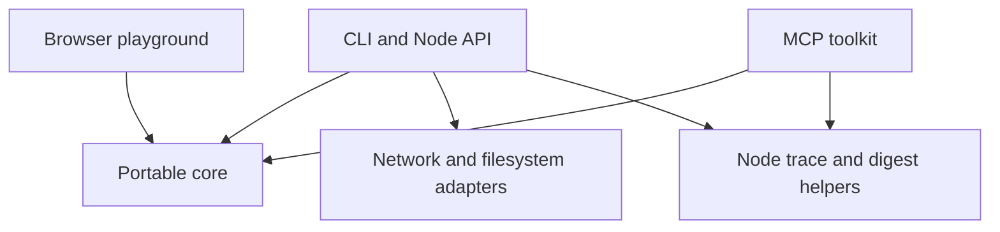

# Architecture

Hardwire turns application action descriptions into data that an integration can
review and validate. The same core serves the browser playground, Node library,
CLI and local MCP server. The panel and trace formats remain version 1.

## Boundaries

| Module | Responsibility | Allowed effects |
| --- | --- | --- |
| `panel-schema.mjs` | Normalize contracts, enforce confirmation floors, validate arguments, summarize declarations | None |
| `infer-html.mjs` | Extract candidate actions from static HTML and create reviewable drafts | None |
| `mcp.mjs`, `score.mjs`, `canonical.mjs` | Compile descriptions, compare contracts and encode bounded JSON | None |
| `browser.mjs` | Export portable functions and async panel hashing through Web Crypto | Platform hashing only |
| `panel.mjs`, `trace.mjs` | Preserve the synchronous Node API and build or check trace digests | Node cryptography |
| `probe.mjs`, `infer.mjs`, `corpus.mjs` | Explicit network and filesystem operations | Bounded reads through documented adapters |
| `toolkit.mjs`, `mcp-server.mjs` | Expose five fixed inspection tools through the official MCP SDK | Stdio transport; no supplied action execution |
| `playground/model.mjs`, `worker.mjs` | Keep the bounded inspection helpers available for experiments | Worker messaging only |
| `playground/comparison.mjs` | Validate and dispatch fixed session, invoice and preference handlers; bind approval to exact requests | Local fixtures and call records |
| `examples/calendar.mjs` | Plan and apply an approved batch with conflict checks and undo | In memory calendar example |
| `playground/app.mjs` | Replay illustrated UI navigation alongside direct calls and collect demo approval | Local DOM only |

The Node entry points remain compatible. `hardwire/browser` has no Node imports,
polyfills, package dependencies, filesystem or network adapter. Its
`panelDigestAsync` produces the same SHA256 value as Node's synchronous
`panelDigest`. Both hash the same canonical normalized panel. Platform crypto
provides hashing in both environments.

## Playground data flow

Three comparisons present the same application outcome through cursor navigation
and a direct typed action. Each route owns an independent fixture instance and
uses the same fixed handler. The public UI does not infer a contract or ask an
LLM to choose a tool. It illustrates what an integration can do with a reviewed
panel and application owned handlers.

`comparison.mjs` defines three ports: `start-session`, `pay-invoice` and
`set-preferences`. Every call snapshots its inputs, compares the supplied panel
digest to the reviewed contract, validates arguments with the shared core and
dispatches only the scenario's known handler. The rendered result comes from the
returned state. Calls are single use per fixture, including concurrent requests.

Sign in declares user confirmation; payment declares owner confirmation. An
explicit demo button issues one approval object per route, bound to the exact
arguments and fixture instance. Each object is consumed once. The level is a
local UI assertion, not authenticated proof of identity. This is neither an OAuth
implementation nor a payment integration, remote authorization protocol or defense
against arbitrary scripts already running in the same page. Real integrations
must perform their own authentication, authorization and provider approvals.

Settings is a reversible local write with no confirmation floor. Sign in and
payment approvals are collected before either route starts. Cancelling a dialog
dispatches nothing. Reset aborts outstanding work and replaces both disposable
fixtures, even when the direct route already finished. Reset does not represent
a payment refund or cancellation of a real external action. Reloading also starts
fresh. Every call checks cancellation after asynchronous validation and before
dispatch. Call records are debug data, not signed receipts or Hardwire traces.

The cursor replay is deliberately paced for visibility. Its duration is not a
benchmark, and direct execution carries no latency guarantee. Reduced motion
removes cursor movement and paced waits. No account is connected and no fixture
data is persisted or sent to a server. Page delivery uses the hosting provider.
The separate calendar and Node catalogue examples remain available to developers.
The inspection worker is not loaded by these comparisons.

## Serving and distribution

`npm run demo` serves the playground at `/playground/` and keeps the original
fixture origin at `/` for probe and inference experiments. The server serves an
explicit asset allowlist. It does not expose repository files through arbitrary
paths. The packaged demo includes the same assets as the checkout.

`npm run build:playground` copies only portable source modules, static assets and
the license into `output/playground`. There is no bundler or third party script.
The public GitHub Pages workflow runs the full checks before deploying this
artifact from main. GitHub Pages must use GitHub Actions as its publishing source.
The workflow uses pinned actions and grants deployment permissions only to the
deploy job. It needs no persistent publishing token.

Rollback the demo by reverting a change on main and letting the workflow deploy
again. Package releases use immutable version tags and checksummed tarballs;
publish a new version to change a package. Do not replace existing assets.

## Verification and remaining scope

Tests cover cross runtime output and digest parity, schema enforcement, malformed
and oversized inputs, inference limits, static packaging, local HTTP serving and
installed package exports. Existing tests also cover the official MCP transport,
trace consistency and known corpus failures. Browser acceptance checks cover
all three results, approval cancellation, reset, replay, keyboard focus and
responsive layout. Comparison tests reject changed contracts, malformed arguments,
forged or reused approvals and concurrent duplicate calls. They verify owner
confirmation, cancellation before dispatch and isolation from caller mutations.
The separate calendar tests retain conflict planning, atomic writes and undo.

This is a complete foundation for describing and experimenting with actions. A
general execution system remains outside the implementation: it would need
application owned handlers, authentication, authorization, real approval checks,
result validation and retry policies. An inferred effect is a guess. A matching
digest establishes consistency, not authenticity or execution. See
[the roadmap](ROADMAP.md) for the evidence required before expanding that scope.
