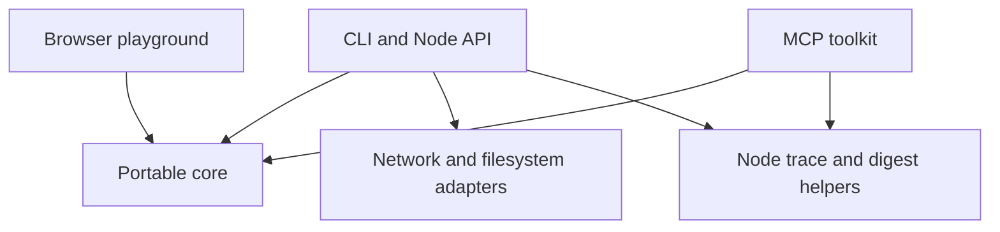

# Architecture

Hardwire turns application action descriptions into data that an integration can
review and validate. The same core serves the browser playground, Node library,
CLI and local MCP server. The panel and trace formats remain version 1.

## Boundaries

| Module | Responsibility | Allowed effects |
| --- | --- | --- |
| `panel-schema.mjs` | Normalize contracts, enforce confirmation floors, validate arguments, summarize declarations | None |
| `infer-html.mjs` | Extract candidate actions from static HTML and create reviewable drafts | None |
| `mcp.mjs`, `score.mjs`, `canonical.mjs` | Compile descriptions, compare contracts and encode bounded JSON | None |
| `browser.mjs` | Export portable functions and async panel hashing through Web Crypto | Platform hashing only |
| `panel.mjs`, `trace.mjs` | Preserve the synchronous Node API and build or check trace digests | Node cryptography |
| `probe.mjs`, `infer.mjs`, `corpus.mjs` | Explicit network and filesystem operations | Bounded reads through documented adapters |
| `toolkit.mjs`, `mcp-server.mjs` | Expose five fixed inspection tools through the official MCP SDK | Stdio transport; no supplied action execution |
| `playground/model.mjs` | Coordinate inspection and validation for the fixed theme action | None |
| `playground/worker.mjs`, `app.mjs` | Isolate validation, replay the UI route and apply a checked theme | Browser worker and local tab appearance |

The Node entry points remain compatible. `hardwire/browser` has no Node imports,
polyfills, package dependencies, filesystem or network adapter. Its
`panelDigestAsync` produces the same SHA256 value as Node's synchronous
`panelDigest`. Both hash the same canonical normalized panel. Platform crypto
provides hashing in both environments.

## Playground data flow

The page itself is the demonstration. A visitor requests a theme change. The
browser route is an explicitly labelled scripted cursor replay through settings.
The Hardwire route validates a request against the application's fixed theme
contract and applies the checked theme directly to the current tab. There is no
LLM, browser automation service or claim of measured agent performance.

The theme contract declares a reversible write and permits execution without
confirmation. A module worker checks its digest against the original contract,
then validates the theme enum and closed argument schema using the shared core.
The UI applies only the checked result. A supplied panel cannot select an
arbitrary handler, endpoint or executable code. Validation is separate from the
small application owned DOM handler.

The replay's timing is illustrative. No fabricated latency or benchmark is
shown. Both routes operate on the same tab. The interaction is keyboard operable,
has a cancellation action, restores the original theme on cancellation or error,
and respects reduced motion. Pending worker work is terminated on cancellation
or after five seconds. Inputs are not persisted or sent to a server. Page delivery
still uses the hosting provider. The Node consumer remains a separate fake
catalogue example.

## Serving and distribution

`npm run demo` serves the playground at `/playground/` and keeps the original
fixture origin at `/` for probe and inference experiments. The server serves an
explicit asset allowlist. It does not expose repository files through arbitrary
paths. The packaged demo includes the same assets as the checkout.

`npm run build:playground` copies only portable source modules, static assets and
the license into `output/playground`. There is no bundler or third party script.
The public GitHub Pages workflow runs the full checks before deploying this
artifact from main. GitHub Pages must use GitHub Actions as its publishing source.
The workflow uses pinned actions and grants deployment permissions only to the
deploy job. It needs no persistent publishing token.

Rollback the demo by reverting a change on main and letting the workflow deploy
again. Package releases use immutable version tags and checksummed tarballs;
publish a new version to change a package. Do not replace existing assets.

## Verification and remaining scope

Tests cover cross runtime output and digest parity, schema enforcement, malformed
and oversized inputs, inference limits, static packaging, local HTTP serving and
installed package exports. Existing tests also cover the official MCP transport,
trace consistency and known corpus failures. Browser acceptance checks cover
both interaction routes, theme reversal, cancellation, responsive layout and
reduced motion. Automated tests reject changed contracts and invalid themes.

This is a complete foundation for describing and experimenting with actions. A
general execution system remains outside the implementation: it would need
application owned handlers, authentication, authorization, real approval checks,
result validation and retry policies. An inferred effect is a guess. A matching
digest establishes consistency, not authenticity or execution. See
[the roadmap](ROADMAP.md) for the evidence required before expanding that scope.
